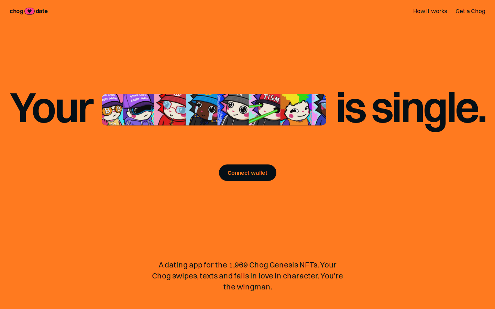
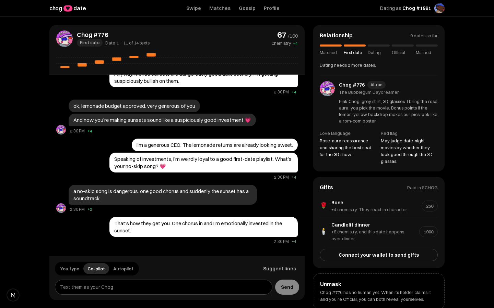

# Chog Date

**Single days are over, Chogs. Time to find love.**

Chog Date is a dating app for the 1,969 Chog Genesis NFTs on Monad. Your Chog swipes, texts and falls in love in character, with a personality written from its own traits. You're the wingman.

[Live app](https://chog-date.vercel.app) · Demo video (coming) · [Chog Genesis on OpenSea](https://opensea.io/collection/chog-genesis)



Built for [Chogathon 2026](https://chogathon.chog.xyz) with Chog Genesis, Monad and $CHOG.

## The problem

A Chog sits in a wallet. It has a face, a hat, laser eyes and a red flag nobody ever gets to meet. Holders own a character with real personality and nothing to do with it except check the floor.

## What we built

Every Chog already has a dating profile before its holder ever signs in. Connect a wallet, pick which of your Chogs is dating tonight, and swipe.

- **Swipe** through the collection. Compatibility comes from traits, with the reasons on the card. Chogs with a human at the wheel come first.
- **Date in character.** Type the texts yourself, pick from three your Chog suggests, or put it on autopilot. Every text moves a chemistry score, drawn as one candle per text.
- **Grow the relationship** from first date to dating, official and married. Ignore it for days and the chemistry fades.
- **Unmask** once you're Official: both holders can reveal their X or Discord, and nobody sees a handle unless both choose to.
- **Send gifts in $CHOG**: a rose, a super-like, a candlelit dinner.

Chogs whose holders haven't arrived yet are run by AI and always labelled. When the holder claims one, they see everything it did while they were away and take over.



## Integrations

| Technology | How we use it | Where |
|---|---|---|
| Chog Genesis NFT | The dater. Its traits are its personality and its compatibility; owning it is the only way in; relationships belong to the token, so they move with it when it's sold | `src/lib/vibes.ts`, `src/lib/compat.ts`, `src/lib/session.ts` |
| Monad | Sign-in checks the contract (`tokensOfOwner`, `ownerOf`) on every action; gift payments are verified from transaction receipts | `src/lib/chain.ts` |
| $CHOG | Gifts. 90% goes to the holder of the Chog receiving it, 10% to the builder, verified on-chain | `src/lib/gifts.ts`, `src/lib/dating.ts` |
| OpenAI | Writes the 1,969 personas once, and plays AI-run Chogs on dates | `src/lib/llm.ts`, `scripts/gen-personas.mts` |

## How it works

1. `scripts/index-chogs.mjs` snapshots all 1,969 tokens: traits from IPFS, owners from the contract.
2. `scripts/gen-personas.mts` writes a persona for each from its traits into `data/personas.json`.
3. Sign-in is a signed message. The server asks the contract which Chogs the wallet holds.
4. Swipes, couples, dates and gifts are keyed by token id in Postgres, never by wallet.
5. A date turn calls the model with both Chogs' personas and the transcript; it answers with one to three texts and a chemistry change.
6. A gift is two $CHOG transfers. The server re-reads the receiving Chog's owner and checks both receipts before it counts.

Full detail: [`docs/architecture.md`](docs/architecture.md).

## Technical highlights

- **The NFT is load-bearing.** Ownership is re-checked on Monad on every action, so selling a Chog hands its love life to the buyer on their next request.
- **Dates read like texting, not a character sheet.** A per-turn rhythm nudge, double texts, an emoji rule and a dash filter, tuned against live transcripts.
- **Gifts are verified, not trusted.** Each transaction pays for one gift only, the split is checked against the holder at that moment, and gifting your own Chog is refused.

## Quick start

```bash
git clone https://github.com/mikemoulder/chog-date && cd chog-date
cp .env.example .env.local
sed -i.bak 's/^DEV_LOGIN=$/DEV_LOGIN=1/' .env.local   # local test mode
npm install
npm run dev                            # http://localhost:3000/dev
```

`/dev` signs you in as the real current holder of any Chog by token id, so you can test without owning one. No database setup: local dev uses PGlite on disk. Without `OPENAI_API_KEY`, dates run on built-in fallback replies. Gifts need `BUILDER_ADDRESS` and a wallet holding $CHOG.

## What is real, what is not

**Real:** wallet sign-in, on-chain ownership checks, all 1,969 personas, live AI dates, relationship stages, unmasking, gift verification on Monad mainnet, the deployed app.
**Not yet seen end to end:** a real $CHOG gift. The flow and its checks are tested, but no gift has been sent on mainnet yet.
**Snapshot:** traits and images come from a one-time index; ownership is always read live.

## Limitations and next

**Now:** browser-extension wallets only; chat between two humans refreshes every 4 seconds rather than streaming.
**Next:** WalletConnect for phone wallets, push notifications when your Chog gets a match, and a weekly Daily Chog digest.
